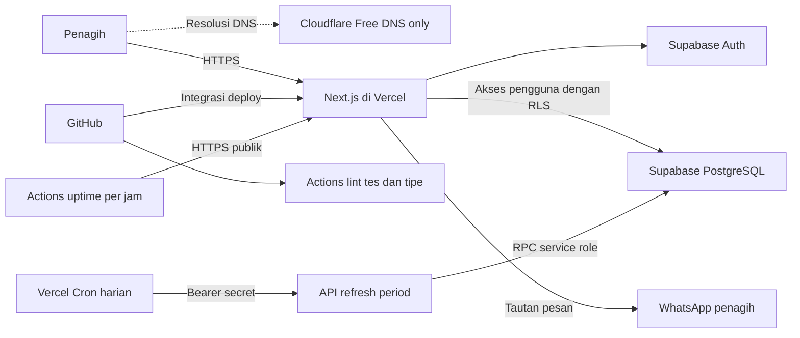

# Arsitektur target dan panduan aktivasi

Cloudflare berperan sebagai DNS otoritatif pada arsitektur target. Koneksi HTTPS tetap langsung ke Vercel. GitHub Actions memeriksa kode dan memantau halaman publik. Vercel Cron menjalankan sinkronisasi periode. Pembukaan room aktif juga mencoba sinkronisasi jika perlu.

## Cloudflare Free

Pemeriksaan DNS pada 8 November 2026 menemukan `ns1.vercel-dns.com` dan `ns2.vercel-dns.com`. Pemilik domain bisa memindahkan DNS melalui langkah berikut.

1. Salin zona DNS dari penyedia sekarang, termasuk `A`, `AAAA`, `CNAME`, `MX`, dan `TXT` yang ada. Catat nameserver lama untuk rollback dan cek apakah DNSSEC atau DS aktif di registrar.
2. Tambahkan `tagihin.my.id` ke Cloudflare sebagai zona **Free**. Cocokkan hasil pemindaian Cloudflare dengan salinan zona. Ambil nilai A/CNAME yang tepat dari **Vercel → Project → Settings → Domains**. Atur record web ke **DNS only** (awan abu-abu).
3. Setelah semua record cocok, selesaikan langkah DNSSEC sesuai panduan Cloudflare, lalu ubah nameserver di registrar ke dua nameserver yang ditampilkan di dashboard Cloudflare. Tunggu status **Active**. Aktifkan kembali DNSSEC dan perbarui DS sesuai panduan jika sebelumnya digunakan.
4. Verifikasi `Resolve-DnsName tagihin.my.id -Type NS` dari resolver publik. Cek domain di Vercel, HTTPS `/`, `/kebijakan-privasi`, dan alur masuk dari perangkat lain. Verifikasi juga layanan yang memakai MX/TXT bila ada. Jika perlu rollback, pulihkan nameserver lama beserta konfigurasi DNSSEC yang sesuai.

Rujukan resmi [Aktivasi DNS Cloudflare](https://developers.cloudflare.com/dns/zone-setups/full-setup/setup/), [Domain kustom Vercel](https://vercel.com/docs/domains/set-up-custom-domain), [Rekomendasi mode DNS only](https://vercel.com/kb/guide/vercel-waf-vs-cloudflare-waf).

## GitHub Actions dan uptime

- **TagihIn CI** berjalan saat push, pull request, atau dipicu manual. Isinya ESLint, tes aplikasi dan database lokal, serta pemeriksaan tipe Next.js/TypeScript. Tes database menggunakan role sintetis, sehingga workflow tidak memerlukan kredensial Supabase.
- **TagihIn Uptime** mencoba HTTPS `/` dan `/kebijakan-privasi` pada menit 17 setiap jam. Setelah perubahan masuk ke branch default, pilih **Actions → TagihIn Uptime → Run workflow**. Gunakan riwayat run untuk investigasi, dan aktifkan notifikasi kegagalan GitHub pada akun yang akan memantau.
- Workflow melaporkan ketersediaan HTTP dua halaman dari runner GitHub. Autentikasi, database, dan pengiriman WhatsApp perlu diperiksa terpisah. Jadwal GitHub bisa terlambat. Pada repo publik, GitHub dapat menonaktifkan jadwal setelah 60 hari tanpa aktivitas. [Dokumentasi jadwal GitHub Actions](https://docs.github.com/en/actions/reference/workflows-and-actions/events-that-trigger-workflows#schedule)
- Jika cek gagal, coba URL dari koneksi lain, cek tab Deployments di Vercel, lalu cek DNS dan status Supabase sesuai gejala. Catat waktu, kode HTTP, penyebab, dan waktu pulih.

## Pemeriksaan sebelum pilot

1. Terapkan migrasi di lingkungan uji dengan akun pemilik. Jalankan uji dua akun melalui browser dan pastikan pemilik dapat melihat room sendiri. Buka URL room penagih A dari akun B dan periksa respons 404. Ulangi pada riwayat dan pastikan data A tidak muncul.
2. Pastikan `CRON_SECRET` dan `SUPABASE_SERVICE_ROLE_KEY` tersedia hanya di konfigurasi server Vercel. Cek satu eksekusi cron dan jumlah room yang gagal di log. Jadwal di `vercel.json` adalah `00:00 UTC` atau `07:00 WIB`, dengan waktu eksekusi mengikuti ketentuan paket hosting.
3. Uji satu room berisi tiga anggota contoh, cek total dan sisa pembagian, tandai satu lunas, lalu buka riwayat. Buka pratinjau WhatsApp menggunakan nomor uji yang dikendalikan tim.
