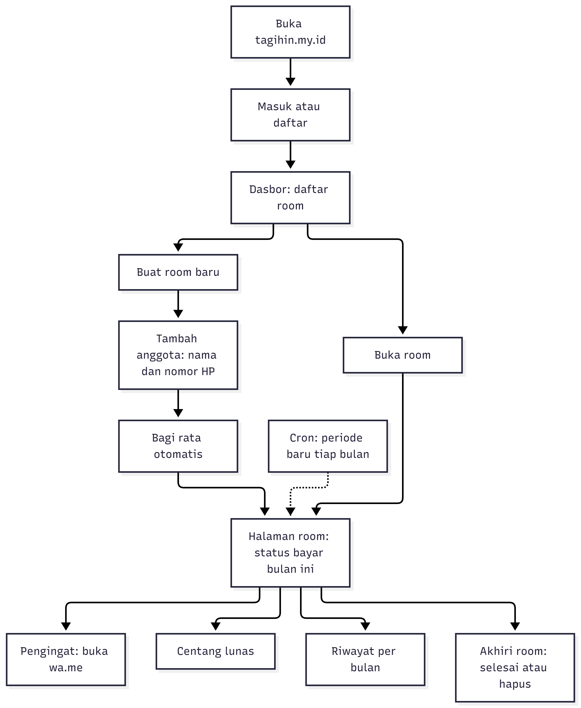
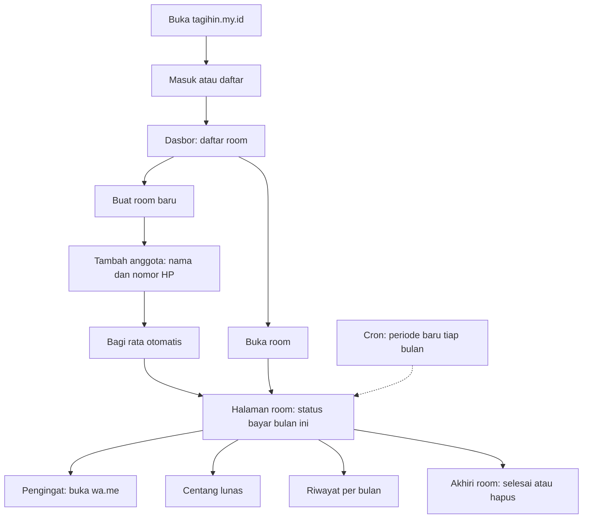
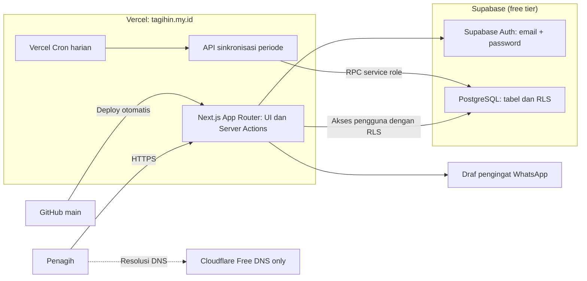
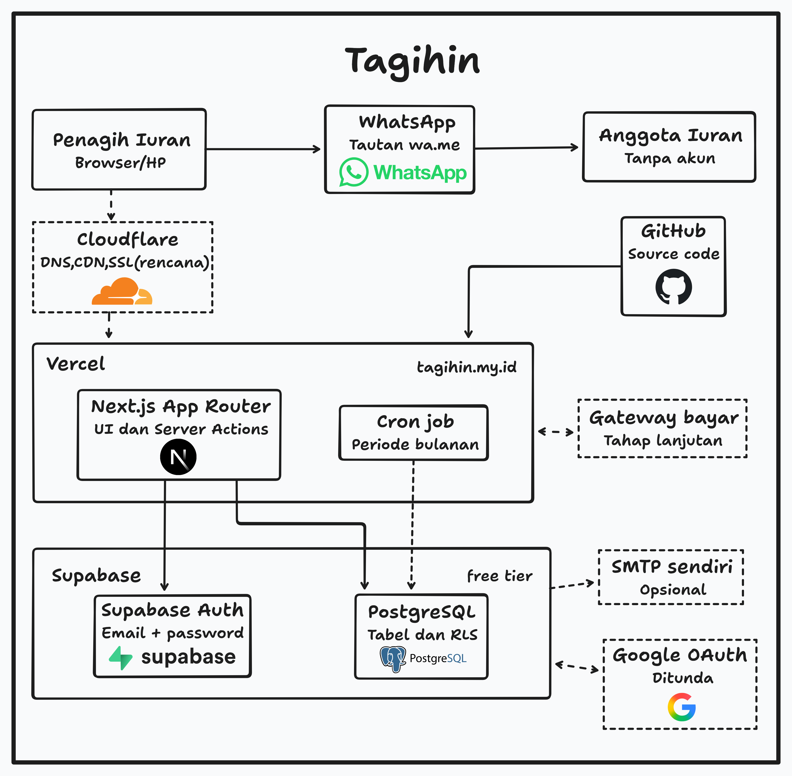
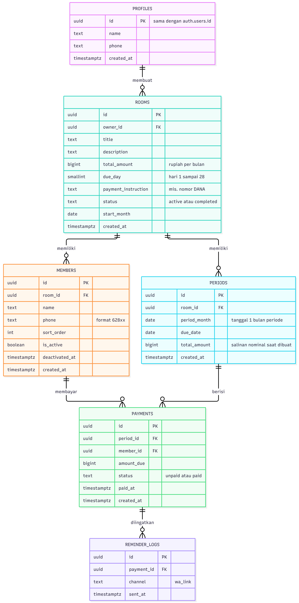
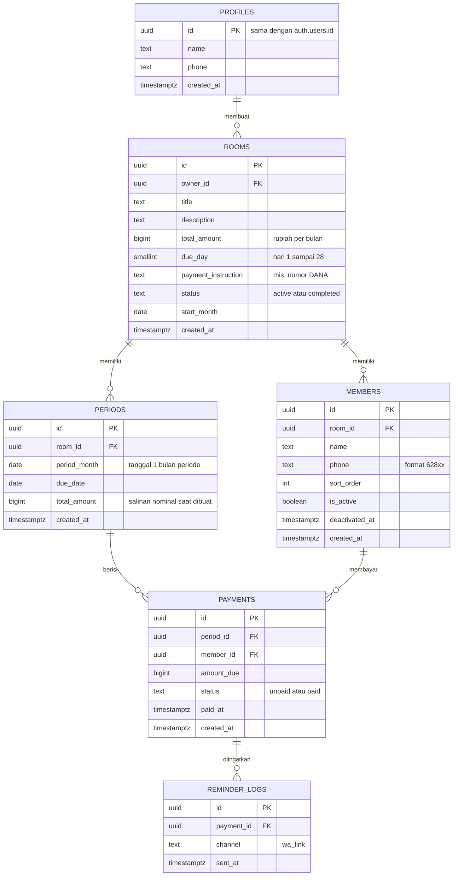

<!--
  PANDUAN MENUKAR DIAGRAM DENGAN GAMBAR
  Simpan 3 file gambar ini di folder docs/images/ pada repositori:
    - erd.png            -> bagian "Skema Database (ERD)"
    - alur-penagih.png   -> bagian "Alur Penagih"
    - infrastruktur.png  -> bagian "Arsitektur Infrastruktur"
  Format .svg juga bisa, cukup ubah ekstensi di tag  terkait.
  Diagram Mermaid di dalam <details> adalah cadangan dan boleh dihapus kalau gambar sudah terpasang.
-->

<div align="center">

# TagihIn

**Kelola iuran bersama tanpa ribet: bagi rata otomatis, catat siapa yang sudah bayar, ingatkan lewat WhatsApp.**

[](https://nextjs.org)
[](https://supabase.com)
[](https://vercel.com)


[Situs](https://tagihin.my.id/) · [Alur Penagih](#alur-penagih) · [Infrastruktur](#arsitektur-infrastruktur) · [ERD](#skema-database-erd) · [Memulai](#memulai) · [Minggu 5 dan 6](docs/minggu-5-6/README.md)

</div>

---

## Tentang

Iuran bulanan di kos, kontrakan, kelas, atau lingkungan warga umumnya dikelola lewat chat grup dan catatan manual. TagihIn adalah aplikasi web untuk **penagih iuran**: buat room iuran, masukkan anggota (nama dan nomor HP), dan aplikasi membagi tanggungan secara rata setiap bulan.

Masalah yang ingin diselesaikan (masih berupa hipotesis dan akan diuji lewat pilot):

- Sulit melacak siapa yang sudah dan belum membayar tiap bulan.
- Pengingat harus diketik ulang ke setiap anggota.
- Riwayat pembayaran bulan lalu tidak terdokumentasi rapi.
- Pembagian nominal per orang dihitung manual.

> **Catatan:** uang tidak melewati sistem. Pembayaran dilakukan di luar aplikasi (transfer atau tunai), dan penagih menandai status lunas sendiri. Anggota tidak perlu membuat akun.

## Fitur

**Sudah diimplementasikan**

- [x] Setup Next.js dan deploy ke Vercel
- [x] Login email + password (Supabase Auth)

- [x] Skema database dan Row Level Security (RLS)
- [x] Room iuran dan manajemen anggota (nama + nomor HP)
- [x] Pembagian rata otomatis
- [x] Periode bulanan otomatis
- [x] Checklist status lunas dan riwayat per bulan
- [x] Draf pengingat WhatsApp (tautan `wa.me` yang dibuka oleh penagih)
- [x] Halaman kebijakan privasi

**Ditunda atau tahap lanjutan**

- [ ] Login dengan Google
- [ ] Pembayaran online (QRIS/Virtual Account)

## Alur Penagih

<div align="center">
  
</div>

<details>
<summary>Versi teks (Mermaid)</summary>



</details>

## Arsitektur Infrastruktur

Domain `tagihin.my.id` terdaftar di IDwebhost. DNS publik menggunakan Cloudflare Free dalam mode **DNS only**, dengan nameserver `decker.ns.cloudflare.com` dan `diva.ns.cloudflare.com` yang terverifikasi pada 8 November 2026. Browser terhubung langsung ke Vercel melalui HTTPS. Push atau merge ke `main` memicu deploy produksi di Vercel.



Lihat [panduan konfigurasi infrastruktur](docs/minggu-5-6/infrastruktur.md) untuk pengaturan DNS, GitHub Actions, dan pemantauan uptime.

<details>
<summary>Diagram rancangan awal</summary>



</details>

## Skema Database (ERD)

<div align="center">
  
</div>

<details>
<summary>Versi teks (Mermaid)</summary>



</details>

**Aturan data penting:** satu periode per room per bulan, satu tagihan per anggota per periode, nominal berupa bilangan bulat rupiah, anggota dinonaktifkan (bukan dihapus) agar riwayat tetap utuh, dan RLS membatasi akses hanya untuk penagih pemilik room.

## Teknologi

| Lapisan | Teknologi |
|---|---|
| Frontend dan server | Next.js (App Router) |
| Autentikasi | Supabase Auth |
| Database | Supabase PostgreSQL (dengan RLS) |
| Hosting | Vercel (deploy otomatis dari GitHub) |
| DNS | Cloudflare Free (DNS only) |
| Pengingat | Tautan `wa.me` |

## Pengujian Minggu 5 dan 6

- **Tes lokal.** 20 tes otomatis lulus, mencakup isolasi RLS antarpenagih, akurasi pembagian rupiah, dan riwayat lintas periode. Jalankan ulang dengan `npm test`.
- **Supabase produksi.** Ketiga migrasi tercatat. Saat penagih menulis tagihan, policy RLS memastikan anggota dan periodenya berasal dari room yang sama. Pemeriksaan database mengonfirmasi bahwa semua tagihan yang sudah ada memenuhi aturan itu. [Migrasi RLS November](supabase/migrations/20261108000000_scope_payment_members.sql)
- **Uji aplikasi.** Pemilik proyek sudah menjalankan pengujian dengan dua akun setelah migrasi produksi.
- **CI dan uptime.** Workflow tersedia di repo. Pemantauan per jam mulai dijadwalkan saat workflow uptime masuk ke branch default GitHub.

Panduan dan formulir uji coba dengan kelompok iuran tersedia di [panduan pilot](docs/minggu-5-6/pilot.md).

## Memulai

**Prasyarat:** Node.js, akun Supabase, dan akun Vercel (opsional untuk deploy).

```bash
git clone https://github.com/RegaCode4/tagihin.git
cd tagihin
npm install
```

Buat berkas `.env.local` di root proyek:

```env
NEXT_PUBLIC_SUPABASE_URL=https://<project-ref>.supabase.co
NEXT_PUBLIC_SUPABASE_ANON_KEY=<anon-key>
```

> Nama variabel mengikuti kode di repositori ini. Sesuaikan bila berbeda.

Di dashboard Supabase, pada pengaturan Authentication, tambahkan `http://localhost:3000` dan `https://tagihin.my.id` ke daftar URL redirect yang diizinkan. Lalu jalankan:

```bash
npm run dev
```

Buka `http://localhost:3000`.

Push atau merge ke `main` memicu build Vercel. Setelah build berhasil, versi baru tersedia di `tagihin.my.id`. Untuk perubahan database, cek daftar migrasi dengan `npx supabase db push --remote --dry-run`, lalu terapkan migrasi yang sesuai ke proyek Supabase yang terhubung.

## Keterbatasan

- Status lunas dicatat manual oleh penagih, bukan otomatis.
- Pengingat dikirim lewat WhatsApp milik penagih sendiri, bukan pengiriman otomatis.
- Ketentuan penyimpanan nama dan nomor HP anggota tersedia di [kebijakan privasi](https://tagihin.my.id/kebijakan-privasi).
- Berjalan di tier gratis Vercel dan Supabase, sehingga tunduk pada batas layanan masing-masing.

## Tim

- **Project Lead:** Adip Habibullah
- **Konteks:** tugas mata kuliah Kewirausahaan, 2026
